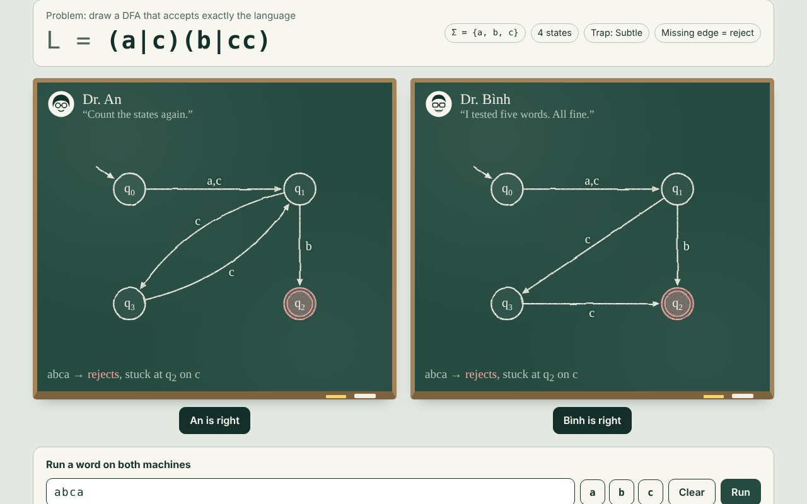

# Who Drew It Right?

A browser game about deterministic finite automata. Each round shows one regular expression and two DFAs drawn on chalkboards by two computer scientists. The machines look almost the same. One accepts exactly the language of the expression. The other is wrong in exactly one place. You pick the correct one.



## Play

Open `index.html` through any static web server:

```bash
npm start          # runs "npx serve ."
# or
python3 -m http.server 8000
```

Opening the file directly from disk also works. Some browsers then block loading the music through `fetch`, and the game falls back to a plain looping audio element.

## Features

- **Random problems.** Regular expressions over `{a, b}` or `{a, b, c}` are generated until one has a minimal DFA with the number of states you asked for (3 to 8).
- **Six kinds of traps.** An edge to the wrong state, a missing edge, an extra edge, two swapped labels, a wrong label, a misplaced accepting state.
- **Trap level instead of size.** Difficulty comes from how deep the mistake hides, not from how many states there are:
  - *Obvious*: same layout on both boards, the mistake shows up on very short words.
  - *Subtle*: same layout, the mistake only changes the result on long words.
  - *Shuffled*: each board names and arranges the states differently, so the pictures cannot be compared directly.
- **Word runner.** Type a word and watch both machines read it step by step.
- **Explanations.** After each pick the game highlights the mistake and gives the shortest word on which the two machines disagree.
- **Two modes.** A fixed number of rounds, or endless play that ends on the first wrong pick. Each mode keeps its own best score in `localStorage`.
- **Settings.** State count, alphabet, trap level, complete or partial DFAs, union symbol (`|` or `+`), rounds per game, music and sound.

## How it works

All automata logic lives in `js/core.js` and has no dependencies.

1. A random regular expression is built from letters, concatenation, union and star.
2. Thompson's construction turns it into an NFA with epsilon moves.
3. The subset construction turns the NFA into a complete DFA.
4. Moore's partition refinement minimises the DFA. States are renumbered in breadth-first order from the start state.
5. Every single-step mutation of the minimal DFA is tried: redirect one transition, swap two transitions of a state, flip one accepting flag.
6. A breadth-first search over the product automaton finds the shortest word on which the original and the mutant disagree. Mutants that are still equivalent are dropped.
7. Only mutants that are themselves minimal with the same number of states are kept, so the wrong machine never gives itself away with an unreachable or redundant state.
8. The trap level picks a mutant by the length of that shortest word.
9. States are placed on an ellipse. The order is chosen by brute force to minimise edge crossings and chord length. A drawn dead state goes in the middle.

The interface in `js/app.js` draws the machines as SVG, with an SVG filter for the chalk look, and plays the music through the Web Audio API with a crossfade at the loop point.

## Project structure

```
index.html          markup
css/style.css       styles
js/core.js          regex -> DFA, mutants, counterexamples, layout
js/app.js           screens, drawing, word runner, audio, settings
audio/ambient.mp3   background music
test/core.test.js   tests for the automata logic
```

## Tests

```bash
npm test
```

The tests compare the generated DFAs against JavaScript's own `RegExp` on random words, and check for every combination of settings that the wrong machine really differs from the correct one and that the reported counterexample proves it.

## Deploy on GitHub Pages

The site is fully static. In the repository settings open **Pages**, choose **Deploy from a branch**, select `main` and `/ (root)`, and save.

## Credits

Fonts: Bricolage Grotesque, Patrick Hand and JetBrains Mono, loaded from Google Fonts.
Music: original ambient track by the author of this repository.
